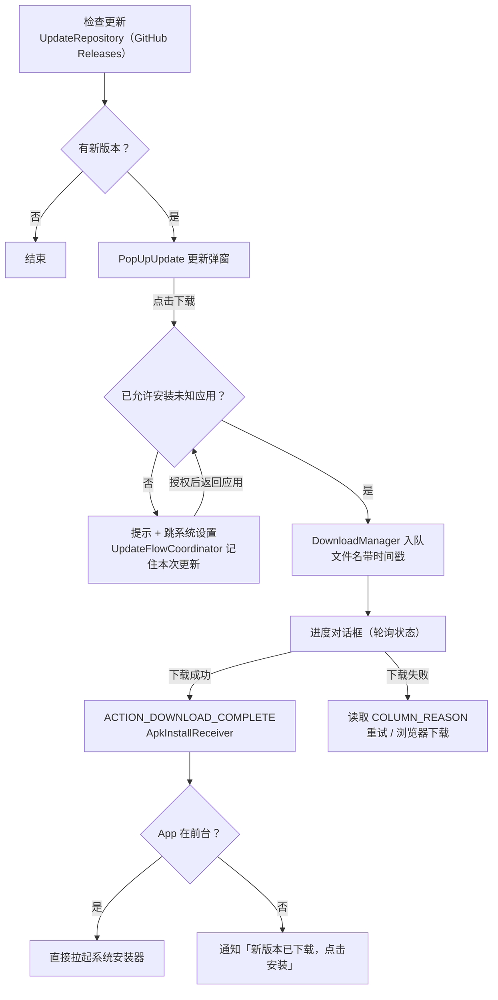

# 应用内更新：检查、下载与安装

面向维护者的说明：更新链路怎么走、哪些系统限制绕不过、以及改代码时容易踩的坑。

## 流程概览



## 代码入口

| 文件 | 职责 |
| --- | --- |
| `data/repository/UpdateRepository.kt` | 拉取 GitHub Releases，比较版本，产出 `CheckUpdateResult`（含 `downloadUrl`） |
| `utils/ActivityUtils.kt` | `downloadAndInstall()`：下载前授权预检、入队下载、进度轮询、失败原因与重试 |
| `update/ApkInstallReceiver.kt` | 静态注册，接收下载完成广播；核对持久化的 downloadId；转发给安装启动器 |
| `update/ApkInstallLauncher.kt` | 构造安装 Intent（content uri 优先）、前台判断、直接启动或发通知 |
| `update/UpdateFlowCoordinator.kt` | 记住"等待授权"的更新，全局 `ActivityLifecycleCallbacks` 在返回应用时自动继续下载 |

## 维护时容易踩的坑

1. **不要从 `BroadcastReceiver` 里 `startActivity`**。Android 10+ 的后台启动限制会静默丢弃，国产 ROM 还叠加"后台弹出界面"开关。授权引导必须在 Activity 中发起；安装确认页改由用户点击通知触发。
2. **不要把 APK 复制进 `PackageInstaller` 会话再提交**。旧实现就是在广播的 `onReceive` 主线程里复制 30 MB+ 文件，广播预算约 10 秒，超时会被系统杀掉，表现为"下载完了却没有安装界面"。现在直接对下载好的 content uri 发起 `ACTION_VIEW`。
3. **下载目标文件名必须唯一**。同名文件会让 `DownloadManager` 直接返回 `STATUS_FAILED`（`ERROR_FILE_ALREADY_EXISTS`），第二次点下载会立刻失败。当前用 `HITA_v<版本>_<时间戳>.apk`。
4. **`clearPendingDownload()` 会同步更新 SharedPreferences 的内存副本**，所以文件名、版本号必须在清理之前读取。
5. **安装用 `DownloadManager.getUriForDownloadedFile()` 的 content uri + `FLAG_GRANT_READ_URI_PERMISSION`**，不要依赖 `/sdcard/Download/...` 路径本身（Android 11+ 分区存储下不一定可读）。FileProvider 只作兜底。
6. **通知渠道**：`app_update`（`ApkInstallLauncher` 内创建）；Android 13+ 需要 `POST_NOTIFICATIONS`。
7. **等待授权的 pending 有 5 分钟 TTL**，避免用户很久以后回到应用突然开始下载。

## 绕不过去的系统限制

- **App 在后台时无法直接弹出安装界面**：只能发通知，由用户点击后再安装（用户发起才不受后台启动限制）。
- **用户关闭了通知权限且 App 在后台**：只能手动到下载目录安装，客户端无解。
- **首次使用需要"安装未知应用"授权**：下载前已引导，若用户中途撤销，会发"去授权"通知。

## 已知限制

- 下载源是 GitHub Releases 的资产直链（会 302 到 `release-assets.githubusercontent.com`），国内速度不可控；本次实现保证"失败有原因、可重试、可改走浏览器"，但不提供镜像加速。

## 手工验证方法

1. **造出"有新版本"**：临时把 `app/build.gradle` 的 `appVersionNameValue` 调低（例如 `3.0.0`）后构建，安装后即可把线上 3.1.0 识别为新版本；验证完记得还原。
2. **撤销安装授权**（debug 包名为 `cn.limpu.hita.diag`）：
   ```bash
   adb shell appops set cn.limpu.hita.diag REQUEST_INSTALL_PACKAGES deny
   ```
3. **恢复授权**：
   ```bash
   adb shell appops set cn.limpu.hita.diag REQUEST_INSTALL_PACKAGES allow
   ```
4. **观察日志**：过滤 `UpdateFlowCoordinator:`、`resumeUpdateDownload:`、`ApkInstallLauncher:`、`ApkInstallReceiver:` 前缀即可看到整条链路。
