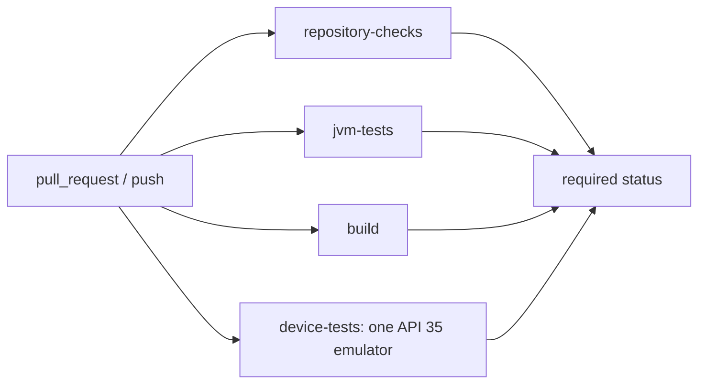

# CI/CD 审查与落地记录

基线：`5992ba381a9d6e87deb7526885f3d957b8a6d09b`

分支：`refactor/agent-06-ci`

最终本地提交：`61ed70279369890e3486a6c5094a2cc6df96ab39`

未 push，未修改分支保护、Rulesets 或 Secrets。远端 GitHub Actions 未触发，不能作为远端 CI 验收。

## 1. 原始结构

只有 `.github/workflows/android-ci.yml`：

- `build-and-test`：仓库检查、四个 Android 模块加 timetable-core 的 JVM 测试、Debug APK、style Release 资源校验串行。
- `device-tests`：API 35 `default/x86_64` 模拟器上串行四个模块的 `connectedDebugAndroidTest`。
- 顶层权限已是 `contents: read`，没有 `pull_request_target`。
- 缺口：第三方 Action 使用可移动 tag；只有模拟器 Job 有超时；没有 concurrency；Gradle Wrapper 没有 `distributionSha256Sum`；模拟器镜像是 AOSP `default`，而本地契约是 `google_apis/x86_64`。

## 2. 新架构



四个 Job 互不依赖，且各自使用独立 runner。模拟器每次新建一台 AVD，不与其他 Job 共享设备。

## 3. 变更清单

- `.github/workflows/android-ci.yml`
- `gradle/wrapper/gradle-wrapper.properties`
- `gradle.properties`
- `scripts/ci/gradle.sh`
- `scripts/ci/repository-checks.sh`
- `scripts/ci/instrumentation.sh`
- `scripts/ci/enable-kvm.sh`

## 4. SHA 固定

|Action|原版本|固定 commit|原因|
|---|---|---|---|
|actions/checkout|v4.2.2|`11bd71901bbe5b1630ceea73d27597364c9af683`|保持 v4 行为|
|actions/setup-java|v4.7.1|`c5195efecf7bdfc987ee8bae7a71cb8b11521c00`|保持 v4 行为|
|actions/setup-python|v5.6.0|`a26af69be951a213d495a4c3e4e4022e16d87065`|保持 v5 行为|
|actions/upload-artifact|v4.6.2|`ea165f8d65b6e75b540449e92b4886f43607fa02`|避免 v5+ 的路径语义变化|
|gradle/actions/setup-gradle|v4.4.1|`ac638b010cf58a27ee6c972d7336334ccaf61c96`|注解 tag 已剥离到 commit|
|reactivecircus/android-emulator-runner|v2.34.0|`1dcd0090116d15e7c562f8db72807de5e036a4ed`|注解 tag 已剥离到 commit|

## 5. 缓存

- `org.gradle.caching=true`，使用本机与 CI 的 Gradle build cache。
- `setup-gradle` 缓存依赖。Fork PR 只读缓存，不写入可信缓存。
- style Release 资源校验仍使用 `--rerun-tasks --no-build-cache`，不被缓存跳过。
- 测试结果、APK 和失败诊断是 Artifact，不是 Cache。

## 6. 权限与安全

- 顶层权限仅 `contents: read`；checkout 关闭 `persist-credentials`。
- 没有不可信事件触发器，没有 `continue-on-error`。
- shell 步骤不拼接 `${{ }}`；PR base SHA 经环境变量传入并加引号。
- 并发组使用工作流名加 PR 号或 ref，`cancel-in-progress: true`。
- 每个 Job 都有超时：检查 10 分钟，JVM 与构建 30 分钟，模拟器 45 分钟。

## 7. 并行关系

`repository-checks`、`jvm-tests`、`build`、`device-tests` 同时开始。仪器测试脚本保持 `--no-parallel`，避免同一模拟器上的设备测试互相覆盖。

## 8. 模拟器

CI 镜像改为 `system-images;android-35;google_apis;x86_64`，Pixel 6，每次无快照启动。本地验收使用独立 AVD `hita_ci_agent06` 和端口 `5574`，不使用已被占用的 `hita_test:5554` 及其他 Agent 的 `5560`、`5570`。本地 Debug APK 于 23 分 44 秒后构建成功，大小 47,553,257 字节；仅向 `emulator-5574` 安装成功，启动后进程 `5183` 的 resumed activity 为 `cn.limpu.hita.diag/cn.limpu.hita.ui.main.MainActivity`。这不是完整仪器测试。失败时 CI 上传 `/tmp/hita-ci-diagnostics/`。不需要 self-hosted runner。

## 9. 耗时

没有远端工作流跑数，因此没有改造前后的完整 CI 分钟数对比。已测得本地 Debug 构建耗时 23 分 44 秒，独立模拟器安装与启动耗时约 25 秒。

## 10. 分支保护建议

以下只是建议，未对远端执行：

- `main` 禁止直接推送和强制推送，包括管理员。
- 至少 1 个审核，并要求解决对话后才能合并。
- 必要状态检查：`Repository checks`、`JVM tests`、`Debug build and style release resources`、`API 35 instrumentation`。
- 合并方式限制为 squash 或 merge，不允许未更新分支合入。
- 仓库协作者增多后再启用 Merge Queue；当前四个门禁已覆盖合并风险，队列会额外消耗一次模拟器时长。
- Ruleset 应覆盖 `main`，限制删除、非快进更新和绕过状态检查。

## 11. 回滚

```bash
git checkout refactor/agent-06-ci
git reset --hard 5992ba381a9d6e87deb7526885f3d957b8a6d09b
```

这会丢弃本分支上的三个本地提交。由于没有 push，远端不需要回滚。
