# 教务与课表数据层一致性审查

- 分支：`refactor/agent-02-data`
- 基线：`5992ba381a9d6e87deb7526885f3d957b8a6d09b`
- worktree：`.worktrees/agent-02-data`
- 远端：本次 `git fetch origin` 连接 `github.com:443` 失败（21.2 秒后退出码 128），未核对远端是否比基线更新。
- 本文只记录已读代码、已执行命令和未运行项。没有实测的性能收益不写数字。

## 数据流

```mermaid
flowchart TD
    UI["课表/成绩/考试入口"] --> EAS["EASRepository"]
    EAS --> SZ["ShenzhenAcademicWebSource"]
    EAS --> BB["BenbuEASWebSource"]
    EAS --> WH["WeihaiEASWebSource"]
    EAS --> WHG["WeihaiGraduateEASWebSource"]
    EAS --> IMP["EASTimetableImportRepository"]
    IMP --> ROOM["Room: timetable / subject / events"]
    IMP --> FILES["变更 JSON 与快照 JSON"]
    USER["用户确认采用"] --> APP["TimetableSourceApplier"]
    APP --> REC["TimetableChangeRecovery.commit"]
    REC --> ROOM
    REC --> OUT["timetable_change_outbox"]
    REC --> FILES
    START["HApplication 启动"] --> REPLAY["recover"]
    OUT --> REPLAY
    REPLAY --> FILES
```



手动导入默认 `REPLACE`：网络课表进入 `prepareImport`，事务内删除该表教务导入课次后写入科目、事件和课表。自动刷新使用 `MERGE`：`TimetableRefreshMergePolicy.plan` 对已有课只生成待确认项，不直接改课；只有新建空课表且允许初始导入时才自动写入。用户确认走 `TimetableSourceApplier`，由 `TimetableChangeRecovery` 把课程写入和文件发布登记到同一个 Room 事务。

## Outbox 恢复协议

|场景|结论|证据|
|---|---|---|
|Room 提交前失败|事务回滚，草稿在 `finally` 丢弃|`TimetableChangeRecovery.kt:36-56`，`TimetableChangeStore.kt:149-157`|
|Room 提交后文件发布失败|课程保留，outbox 行保留，下次恢复重放|`TimetableChangeRecovery.kt:56-60`，`TimetableAtomicFile.kt:39-52`|
|提交过程中崩溃|SQLite 事务全成或全不成；文件先 `fd.sync()` 再 `Os.rename`|`TimetableAtomicFile.kt:43-49`|
|重启恢复|启动时 `recover()`；按时间与 operationId 重放|`HApplication.kt:63-65`，`TimetableChangeOutboxDao.kt:13-17`|
|同一记录执行两次|`appliedOperations` 与状态同一次原子写；快照按 id 与 fingerprint 去重|`TimetableChangeStore.kt:169-204`，`TimetableSnapshotStore.kt:123-140`|
|恢复半程后重试|快照、变更文件、acknowledge 顺序可重入|`TimetableChangeRecovery.kt:69-77`|
|并发提交与恢复|同一把 `TimetableMutationLock`；未恢复完成时拒绝新的 `commit`|`TimetableMutationLock.kt:16-20`，`TimetableChangeRecovery.kt:36-38`|

未改这套机制。`TimetableRecoveryProtocolInstrumentedTest` 已覆盖快照发布失败、变更文件发布失败，以及重建进程后的一次重放和第二次空重放。本次未改恢复代码，也未扩展该测试。

## 已修复

### DL-01 本部研究生课表只认顶层 JSON 数组

- 触发：`kbgl/queryXsckcb` 或 `queryXsckcbyy` 返回 HTTP 200，课表行位于 `data`、`rows`、`content`、`result` 或其嵌套对象中。
- 原行为：`parseTimetable` 对非数组直接返回空列表。调用方只在响应体含 `/common/login` 时判会话失效，否则把空列表当成该学期没有课。
- 修复：沿用深圳解析器已接受的包装键，递归取出第一层课表数组。没有这些键的错误对象、HTML 和登录页仍返回空列表，不发明课程。
- 文件：`BenbuGraduateScheduleParser.kt`、`BenbuGraduateScheduleParserTest.kt`。
- 测试：新增包装键、`data.rows` 嵌套、错误对象和登录 HTML 四类断言。原有顶层数组、实体解码用例保留。

## 已核对但不改

|编号|现象|不改原因|
|---|---|---|
|DL-02|威海考试 `term == null` 时请求硬编码 `2025-20262`|`LegacyExamQueryContractTest.weihaiNullTermKeepsHistoricalDefaultCodeAndNullResultTermFields` 与 `ExamSuspendContractTest.weihaiOnceMatchesLegacyNullTermDefaultAndParserQuirks` 把该请求码锁定为现有契约|
|DL-03|威海考试 401、503、登录页在另有成功时段时返回成功且不带失败消息|`weihaiOnceMatchesLegacySkippedHttpLoginHtmlEmptyAndTransportAbort` 明确锁定|
|DL-04|本部实验课和电子实验课 HTTP 非 200 时返回空列表，正课成功则整张课表成功|会改变现有“实验系统不可用时仍导入正课”的行为；没有独立失败契约可证明应改成整次失败|
|DL-05|深圳成绩 JSON 缺少 `content.list` 时返回空列表|空列表也是合法的零成绩结果；没有响应样本证明缺字段一定是错误|
|DL-06|深圳学分进度多次 `postValue`|调用方是 LiveData 渐进展示，不是数据库写入|
|DL-07|自动 MERGE 对已有课只记 pending|`TimetableRefreshMergePolicy.plan` 的既定策略，已有策略测试覆盖；不是刷新漏写|
|DL-08|科目类型只有写转换器|Room 2.8.4 的 `EnumColumnTypeAdapter` 为非空枚举生成按名字读写；`AppDatabaseUpgradePathTest` 会读回 `COM_A`|
|DL-09|事件索引迁移 SQL 不带反引号，schema 18 带反引号|与已修过的 groupId 索引同类，但本次没有打开旧库实测 Room 拒绝。改迁移会改变已发布升级路径，需先有失败证据|

## 遗留风险

1. **启动恢复不阻塞读取。** `HApplication` 在 IO 协程调用 `recover()`，不看返回值。提交已成功但文件尚未重放时，界面仍可能看到旧的待确认项。下一次 `commit` 会先恢复。改启动时序会影响其他模块，本次不改。
2. **自动刷新缺少当前学期标记时取排序后第一项。** 本部/威海学期按时间升序，第一项是最早学期。当前学期通常由页面选中项补上；两条页面都没有选中项时才会发生。没有线上失败样本，不改选择逻辑。
3. **同名已选课的名称键元数据后写覆盖先写。** 课程代码键各自保留。只有课表项自身没有教师、学分或类别，且两门规范化同名课不同，才会串数据。本次没有这种响应样本。
4. **自动 MERGE 的 Room 写入与变更 JSON 不在同一个 outbox 事务里。** 用户确认路径在 outbox 中；自动刷新路径先改文件状态，再单独 `runInTransaction`。崩溃窗口存在，但把自动刷新塞进现有 outbox 会改变恢复协议的职责，本次不改。
5. **事件时间范围查询没有时间索引。** 现有索引是 `(timetableId, type, source)`。未做查询耗时测量，不加索引，也不写性能收益。

## 测试矩阵

|检查|命令|结果|
|---|---|---|
|仓库卫生与分层|`python scripts/check_repository.py --base-ref 5992ba381a9d6e87deb7526885f3d957b8a6d09b`|通过，退出码 0|
|远端基线|`git fetch origin`|失败，退出码 128，`github.com:443` 连接超时|
|JDK 25 上的 Gradle 测试任务|`gradlew.bat :app:testDebugUnitTest` 与 `:timetable-core:test`|配置失败：`Type T not present`。默认 `JAVA_HOME=D:\JDK` 是 JDK 25.0.5，与 Gradle 8.11.1 不兼容|
|研究生解析测试|JDK 21 下同一命令|第一次编译到 `:app:kaptDebugKotlin` 后被 600 秒工具超时切断，退出码未取得，断言未执行；第二次复用编译结果，`BUILD SUCCESSFUL in 15m 55s`，97 actionable tasks（17 executed，80 up-to-date），退出码 0；`:app:testDebugUnitTest` 执行了该测试类|
|四模块单元测试、core jar、迁移链|JDK 21：`gradlew.bat :app:assembleDebug :app:testDebugUnitTest :hitauser:testDebugUnitTest :component:testDebugUnitTest :style:testDebugUnitTest :timetable-core:test :timetable-core:jar --offline`|`BUILD SUCCESSFUL in 5m 31s`，148 actionable tasks（53 executed，95 up-to-date），退出码 0。XML：app 941 测试、0 失败、0 错误、1 skipped；hitauser 4；component 7；timetable-core 57。`:style:testDebugUnitTest` 为 `NO-SOURCE`。`AppDatabaseMigrationChainTest` 包含在 app JVM 结果中。`AppDatabaseUpgradePathTest` 是仪器测试，未实际运行|
|仪器测试与模拟器|`adb devices` 先后可见 `emulator-5554`、`emulator-5574`|未实际运行。`emulator-5554` 前台是 `cn.limpu.hita.diag`，另一个 Agent 正在使用 `emulator-5574` 构建；不安装、不覆盖、不清数据|

模拟器人工验证清单（本次未执行）：

- 本部研究生当前学期与历史学期课表导入。
- 顶层数组与 `data.rows` 包装响应显示同一门课。
- 错误对象和登录页不显示虚构课程。
- 切换学期、手动改课后自动刷新仍只产生待确认，不直接覆盖。
- 文件发布失败后重启，课程保持新版本且待确认状态恢复一次。

## 回滚

只回滚本次解析改动：

```powershell
git checkout 5992ba381a9d6e87deb7526885f3d957b8a6d09b -- app/src/main/java/cn/limpu/hita/data/source/web/eas/BenbuGraduateScheduleParser.kt app/src/test/java/cn/limpu/hita/data/source/web/eas/BenbuGraduateScheduleParserTest.kt
```

不需要数据库迁移回滚。未推送，未合并 `main`。

## 最终提交

代码修复提交 `1c4a15034674ea90b69fa5019f36eb4a0bdc7b62`。本报告的哈希回填是其后的文档提交，不把变动后的 HEAD 再写回报告，避免提交循环。分支 `refactor/agent-02-data`。提交时 `git merge-base --is-ancestor 5992ba381a9d6e87deb7526885f3d957b8a6d09b HEAD` 退出码 0。未 push，未合并 main。
