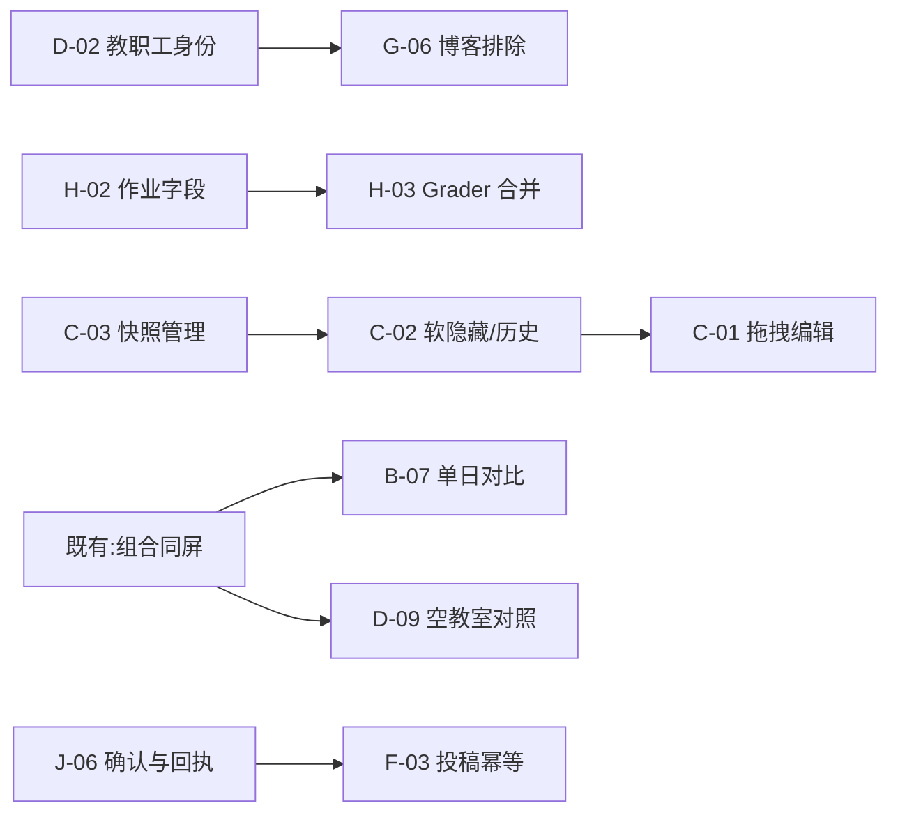

# iOS → Android 迁移方案与决策清单

配套审计：[2026-11-14-ios-android-feature-diff.md](2026-11-14-ios-android-feature-diff.md)
生成时间：2026-11-14。**本文件只做方案设计与决策记录；在你逐项批准前不改任何业务代码。**

## 一、方案命名

| 记号 | 含义 |
|---|---|
| 方案 A | 行为对齐：沿用 iOS 的业务规则与流程，用 Android 原生实现 |
| 方案 B | Android 原生适配：保核心功能，按现有架构/组件/交互重做 |
| 方案 C | 复用整合：扩展 Android 已有的等效能力，不新增并行实现 |
| 方案 D | 简化 / 延后 / 不迁移 |

## 二、每项可迁移差异的方案与取舍

### P0 组（安全与正确性）

#### J-06 Agent 危险操作确认与结果未知回执

- 现状：`AddActivityTool.kt:29-36`、`SubmitReviewTool.kt:83-88` 直接写入；`ReActToolRegistry.kt:26-28` 把非抛错结果一律记为 `unknown`。
- 方案 A：对所有写工具加「二次确认」步骤，由 UI 弹确认卡；结果区分 `succeeded / failed / outcome_unknown`，unknown 不自动重试。
- 方案 B：只给影响最大的两个工具（添加日程、提交评价）加确认，其余保持。
- 方案 C：把 `ReActTool` 返回值从自由文本改成带 status 的结构，确认逻辑下沉到 `LlmChatService` 的 action 分发点。
- 影响面：`agent/tools/*`、`agent/llm/LlmChatService.kt`、`ui/main/agent/*`。无数据库/协议改动。
- 推荐：**C 打底 + A 的确认卡**。理由：状态枚举是回执正确性的根，确认卡只解决「有提示」；只做 B 会留下「unknown 被当成功」的隐患。
- 验证：单测覆盖 unknown 不重试；模拟器手工走一次「提交评价」确认流程。

#### F-03 投稿幂等与 PR 历史回读

- 现状：**两条投稿路径都不是幂等键**——UI 的 `HoaResourceSource.kt:409` 用 `UUID.randomUUID()`；Agent 的 `PrServerClient.kt:26-32` 用 `System.nanoTime()` 拼 key。任一路径超时重试都会生成新 key。
- 方案 A：本地持久化 `idempotencyKey`（内容哈希 + 课程码，不含时间），超时后查询而非重投；两条路径共用同一 key 生成器。
- 方案 B：只在提交前写入「进行中」标记，失败时不自动重试，让用户手动决定。
- 方案 C：接入服务端幂等键（需后端配合，属协议变更）。
- 影响面：`data/repository/HoaRepository.kt`、`ui/resource/CourseContributionActivity.kt`、可能需要 Room 新表。
- 推荐：**A**（端上幂等即可解决绝大部分重复 PR）。C 需后端授权，不在默认范围。
- 验证：制造超时场景的单测 + 用真实 HOA 仓库跑一次 dry-run（需你提供测试仓库）。

#### C-06 手动教务导入改为差异预览

- 现状：`ImportTimetableActivity.kt:464-468` 手动导入是全量替换；自动刷新才走 `TimetableRefreshMergePolicy`。
- 方案 A：手动导入前复用现有 merge policy 生成差异清单，用户勾选后提交。
- 方案 C：直接把自动刷新的合并逻辑套用到手动导入，仅加确认对话框。
- 推荐：**C**（复用 `TimetableRefreshMergePolicy.kt` 与 `TimetableChangeDialog.kt`，几乎零新增代码）。
- 验证：现有 `EASTimetableImportRepository` 单测 + 构造「本地手工课 + 远端少课」用例。

### P1 组（高价值）

#### G-05 公告与更新双弹去重

- 方案 C：让 `MainUpdatePresenter` 与 `MainNoticePresenter` 共享一个「本次启动已提示版本」标记。
- 推荐：**C**。改动集中在 `ui/main/MainNoticePolicy.kt`、`MainUpdatePresenter.kt`。
- 验证：单测覆盖两通道同时命中只弹一次。

#### A-02 mini 课程条

- 方案 B：新增 Compose 组件挂在 `MainScreen` 的 Dock 之上，数据来自现有 `FragmentTimelineViewModel` 的今日投影；点击进课程详情。
- 方案 C：复用 `DockTabBar` 的层级与动画，只加一条可折叠的课程信息。
- 影响面：`ui/main/MainScreen.kt`、`ui/main/timeline/*`、`ui/main/DockTabBar.kt`。
- 推荐：**B**。理由：底部条要跨 tab 存在且不干扰 `TabSwipe`，需独立层；复用 Dock 会污染既有导航。
- 风险：与 FAB/键盘/手势冲突；需在 5 种主题下验证。

#### A-04 小组件配置 + 深链

- 方案 A：补 `android:configure` Activity（选样式/背景/展示范围），点击课程通过 `eventId` 深链到 `MainActivity` 并定位。
- 方案 B：只做深链，配置页延后。
- 推荐：**A 分两步**：先深链（`TodayWidget.kt:66-71` 空分支填实现 + `MainActivity` 解析 intent），再配置页。
- 影响面：`ui/widgets/**`、`AndroidManifest.xml`、`ui/main/MainActivity.kt`。
- 风险：`RemoteViews` 的深链需 `PendingIntent` 模板 + `fillIn`，需真机验证。

#### A-07 课程提醒规则扩展

- 方案 A：把 `CourseReminderStore` 从单 int 扩展为包含 periodRules / courseOverrides / examOverrides 的结构（Room 或 JSON 迁移），`CourseReminderWorker` 按规则展开。
- 方案 B：只增加「多个提前点」（如 15/5 分钟），不做按课程覆盖。
- 推荐：**B 先行，A 作为二期**。理由：`CourseReminderWorker` 是单一 WorkManager 链，直接上规则模型风险高；先多档提前点可覆盖 80% 需求。
- 影响面：`data/source/preference/CourseReminderStore.kt`、`data/work/CourseReminderWorker.kt`、`NavigationFragment.kt` 设置项。
- 风险：`WorkManager` 最小间隔限制；课程量大时排程数量。

#### C-02 软隐藏 + 编辑历史

- 方案 A：给 `EventItem` 加 `hidden` 标记（Room 迁移 v19），删除走软隐藏，新增编辑历史表，恢复入口放课表管理。
- 方案 B：只做「当前会话撤销」（Snackbar），不做持久历史。
- 推荐：**A**。理由：Android 已有 `TimetableSnapshotStore`，但快照恢复是整体回滚，无法解决单条误删。
- 影响面：`AppDatabase`（版本 +1）、`EventItemDao`、`TimetableBatchCoordinator`、`TimetableManagerActivity`。
- 风险：**数据库迁移必须完整**（AGENTS.md 明确要求）；需要 `AppDatabaseUpgradePathTest` 覆盖。

#### C-03 快照管理补齐

- 方案 C：在现有 `TimetableSnapshotStore` 之上加备注、保留策略、删除、统计的 UI 与字段。
- 推荐：**C**。纯扩展，不改既有快照格式（新字段带默认值）。
- 验证：现有快照单测 + 迁移兼容测试。

#### C-08 系统日历同步

- 方案 A：新增 `CalendarSyncRepository`，用 `CalendarContract` 写入课表与考试，处理 `READ_CALENDAR/WRITE_CALENDAR` 权限、逐项回读、部分失败。
- 方案 B：只做「导出 .ics 后手动导入日历」（现有能力已覆盖一半）。
- 推荐：**B 兜底，A 作为目标**。理由：Android 权限弹窗与厂商日历差异大，需先验证 2–3 个 OEM。
- 影响面：新 repository + `TimetableExportSheet` 入口 + `AndroidManifest` 权限。
- 风险：重复写入/时区/全天事件；需幂等键（用课程 ID + 日期）。

#### D-05 成绩分布并入成绩页

- 方案 C：把 `ShenzhenHistoricalGradeAnalyzer` 的分档逻辑抽成纯函数，`ScoreInquiryActivity` 复用并内嵌展示（非深圳校区也能显示百分制课程分布）。
- 推荐：**C**。已有分析代码，只需提取与复用。
- 验证：单测覆盖等级制/通过制课程被排除。

#### D-09 空教室日期/对照

- 方案 A：补按日期节次查询 + 「与我的课表对照」。
- 方案 C：复用 `DisplayScopeResolver` 的当前课表投影做对照，查询接口沿用现有 `ShenzhenAcademicWebSource`。
- 推荐：**C**。对照逻辑已有（`EmptyClassroomActivity.kt:501-517` 的占用判断），只是没接到用户课表。

#### F-01 分源报告 + 搜索历史

- 方案 C：`UnifiedResourceSearchViewModel` 改为返回 per-source 状态（成功/失败/空），UI 显示「HOA 失败」而不是整页空；搜索历史复用 `HoaRepository` 现有 prefs 机制。
- 推荐：**C**。改动集中在 `UnifiedResourceSearchViewModel.kt`、`ExternalResourceRepository.kt`。

#### F-02 资源文件预览与复制

- 方案 C：用已引入的 PDFBox（`libs.pdfboxAndroid`）做应用内 PDF 预览，Markdown 代码块与链接增加复制/分享。
- 推荐：**C**。依赖已在，无需新库。

#### H-02 作业字段扩展

- 方案 A：`HomeworkItem` 增加 subject/submissionMethod/submissionDetail/submissionFormat/attachments，Room 迁移（`homework` 表加列，默认值保证旧数据可读）。
- 推荐：**A**。需与 H-03 的 Grader 合并一起设计，避免二次迁移。
- 风险：**数据库迁移**；附件存储需 FileProvider。

#### I-06 身份可见性

- 方案 C：新增一个布尔偏好 + 在抽屉/我的页隐藏学号姓名。
- 推荐：**C**。极低成本。

#### I-07 一键回归初始状态

- 方案 A：新增 ResetCoordinator，按分量（数据库、偏好、文件、小组件）清理并逐项回读。
- 推荐：**A**（分量式）。不要用 `pm clear` 或暴力删目录。
- 风险：不可撤销，必须二次确认 + 影响清单。

### P2 组（依赖外部能力）

| ID | 方案 | 取舍 | 推荐 |
|---|---|---|---|
| A-03 天气 | A：接第三方（和风/OpenWeather）+ 定位权限；D：不做 | 需 API Key 与配额；与 iOS WeatherKit 数据源不同 | 待你决定是否接受第三方服务 |
| B-06 截图分享 | B：Compose 离屏渲染当前周 + FileProvider 分享 | 需处理壁纸/主题/字体缩放 | A（B 实现） |
| B-07 单日对比 | C：复用组合同屏 + 单日过滤 | 与好友对比功能易混淆 | 建议 D（价值被 B-03 部分覆盖） |
| C-01 拖拽编辑 | B：长按进入拖拽态 | 与 TabSwipe / 滚动冲突 | 建议 D 或延后 |
| C-09 高校协议 | A：WebView 注入 + JSON 解析 | 工作量大，受众为外校 | 建议 D |
| E-01 校园卡 | A：解析 dxcdp 门户 | 接口非公开、易变 | 待你决定 |
| E-02 静音仓 | A | 用户规模小 | 建议 D |
| E-03 图书馆 | A | 同上 | 建议 D |
| E-04 内网服务 | D 维持外链，只补深圳实验中心场次统计 | Android 已有本部实验课并入课表；缺深圳 LIMS 统计 | 按需（仅统计） |
| E-05 校园地图 | A：GeoJSON + 地图 SDK（如 osmdroid/AMap） | 需地理数据与 SDK 授权 | 待你决定 |
| I-08 变现 | A：Play Billing + 权益校验 | 上架政策、分成、合规 | 建议 D（除非有明确商业计划） |

### P3 组（低成本对齐）

| ID | 方案 | 说明 |
|---|---|---|
| B-02 周号跳转 | B | 顶栏加周号选择器，复用 `navigateToWeek` |
| C-07 ICS 逐条预览 | C | 在 `ImportTargetDialog` 前插入预览页，复用 `IcsImportBundleBuilder` 的统计 |
| G-02 讲座入口接线 | C | 在资讯页加入口；先确认真实数据源可用 |
| G-06 教师账号博客排除 | A | `MainTab.showsBlog` 加 `principalKind != staff`（需先有 D-02） |
| H-04 分类型开关 | C | `ScoreReminderStore` 拆成按类型 |
| J-07 搜索根页 | B | 搜索页加 Agent 切换 |

## 三、依赖关系

需要一起迁移（否则语义不完整）：

- **J-06 + F-03**：都是「结果未知」语义，共用一套回执模型。
- **H-02 + H-03**：作业字段与 Grader 合并共用一次 Room 迁移。
- **C-02 + C-03**：软隐藏与快照管理共用课表管理页入口。
- **A-04 + I-05**：小组件深链与小组件配置同属一个设置域。

## 四、需要你决策的清单（全部 86 项）

请对每项给出：**是否迁移 + 采用哪个方案 + 是否只做子集**。可批量回复，例如「P0 全做；A 域只做 A-02/A-04 深链/A-07；B 域不动；P2 全部不做」。

「推荐」列含义：`做` = 方案可直接实施；`做(分步)` = 需拆成多个可独立验收的阶段；`不做` = 平台专属或 Android 已更强，只保护；`待定` = 需你先定外部前提（API Key / 上架政策 / 数据源）。

### P0 安全与正确性

| ID | 功能 | 推荐 | 方案 | 主要取舍 |
|---|---|---|---|---|
| J-06 | Agent 危险操作确认与回执 | 做 | C 打底 + A 确认卡 | 改 `ReActTool` 返回契约，触及全部 15 个工具 |
| F-03 | 投稿幂等 + PR 历史 | 做 | A 端上幂等 | 需新增持久化；服务端幂等需后端授权 |
| C-06 | 手动导入差异预览 | 做 | C 复用 merge policy | 复用 `TimetableRefreshMergePolicy`，几乎零新增代码 |

### P1 高价值

| ID | 功能 | 推荐 | 方案 | 主要取舍 |
|---|---|---|---|---|
| G-05 | 公告/更新双弹去重 | 做 | C 共享启动标记 | 仅体验问题；改 `MainNoticePolicy` + `MainUpdatePresenter` |
| A-02 | mini 课程条 | 做 | B 独立 Compose 层 | 与 TabSwipe/键盘/5 套主题的冲突面 |
| A-04 | 小组件深链 + 配置 | 做(分步) | A：先深链后配置 | 深链改动小；配置页需新 Activity + 偏好 |
| A-07 | 课程提醒规则 | 做(分步) | B 多档先行 → A 规则模型 | 规则模型需偏好迁移；WorkManager 排程数量 |
| C-02 | 软隐藏 + 编辑历史 | 做 | A（Room v19） | 数据库迁移必须完整，需 `AppDatabaseUpgradePathTest` 覆盖 |
| C-03 | 快照管理补齐 | 做 | C 扩展字段 | 新字段带默认值，兼容旧快照 |
| C-08 | 系统日历同步 | 做 | A（B 兜底） | 需 `READ/WRITE_CALENDAR`；OEM 日历差异需真机验证 |
| D-05 | 成绩分布并入成绩页 | 做 | C 复用分析器 | 只需把分档逻辑抽成纯函数 |
| D-09 | 空教室日期/对照 | 做 | C 复用课表投影 | 查询接口沿用深圳 web source |
| F-01 | 分源报告 + 搜索历史 | 做 | C 改 VM 返回结构 | 只改 `UnifiedResourceSearchViewModel` 与 UI 状态 |
| F-02 | 资源文件预览与复制 | 做 | C（PDFBox 已在依赖） | PDF 渲染需真机验证中文 |
| F-04 | 外链白名单 + 导出 | 做 | C | 安全相关，建议与 F-02 同批 |
| H-02 | 作业字段扩展 | 做 | A（Room 迁移） | 必须与 H-03 合并设计，避免二次迁移 |
| I-06 | 身份可见性 | 做 | C 加布尔偏好 | 极低成本 |
| I-07 | 一键回归初始状态 | 做 | A 分量式 | 不可撤销，必须二次确认 + 影响清单 |

### P2 依赖外部前提

| ID | 功能 | 推荐 | 方案 | 主要取舍 |
|---|---|---|---|---|
| A-03 | 今日天气 | 待定 | A 第三方 API + 定位权限 | 需你选天气服务并接受 Key/配额；与 WeatherKit 数据源不同 |
| A-06 | 今日卡片群 | 做(可选子集) | B 逐卡增量 | 建议只做作业环 + 校园通知卡 |
| A-08 | 会话失效隐藏/关闭 | 做 | C 加永久关闭偏好 | 保留现有模态弹窗 |
| B-06 | 截图分享 | 做 | B 离屏渲染 + FileProvider | 壁纸/主题/字体缩放需逐一验证 |
| C-01 | 拖拽改时间/拉伸 | 不做 | B 长按拖拽态 | 与 TabSwipe、滚动冲突，回归面大 |
| C-09 | 高校协议导入 | 不做 | A WebView 注入 | 受众为外校，工作量大 |
| E-01 | 校园卡 | 待定 | A 解析 dxcdp 门户 | 接口非公开、易变 |
| E-02 | 静音仓预约 | 不做 | — | 用户规模小 |
| E-03 | 大学城图书馆 | 不做 | — | 用户规模小 |
| E-05 | 校园地图 | 待定 | A GeoJSON + 地图 SDK | 需地理数据与 SDK 授权 |
| I-08 | 变现 | 待定 | A Play Billing | 上架政策、分成、合规 |
| N-01 | Agent 日配额/权益令牌 | 待定 | A 接后端配额 | 需先有后端与商业策略；否则维持直连 |
| N-02 | 服务端模型路由 | 待定 | A 服务端换档 | 依赖 N-01 |
| N-03 | 每轮宿主指令 | 待定 | A 注入 directive | 依赖 N-01 的服务端协议 |
| N-04 | 类型化功能呈现+上下文回执 | 按需 | A shell 路由层 | 与 A-04 深链同源，改动面大 |
| N-05 | 公告深链 hita:// | 做 | C 加 deepLink 字段 | 小改，与 G-04 同批 |
| I-10 | 欢迎页引导/演示模式 | 做(演示优先) | C 接线死文案 + 演示数据 | `guide_1p` 已有未使用文案 |

### P3 低成本对齐

| ID | 功能 | 推荐 | 方案 | 主要取舍 |
|---|---|---|---|---|
| B-02 | 周号跳转 | 做 | B 顶栏选择器 | 复用 `navigateToWeek` |
| C-07 | ICS 逐条预览 | 做 | C 复用 `IcsImportBundleBuilder` | 低风险 |
| G-02 | 讲座入口接线 | 做(待核实数据源) | C 加入口 | 需先确认 `AdditionalService` 可用 |
| H-04 | 分类型提醒开关 | 做 | C 拆分 store | 小改 |

### 其余可迁移项（按需指定）

| ID | 功能 | 推荐 | 方案 | 主要取舍 |
|---|---|---|---|---|
| B-04 | 壁纸卡片字色自适应 | 按需 | C 扩采样范围 | 与暗色对比度基线需一致 |
| B-05 | 课程详情多选时间组 | 按需 | A 时间组选择器 | 现有三档作用域需保留 |
| B-07 | 单日对比 | 不做 | — | 价值被组合同屏部分覆盖 |
| C-05 | 关注班变更复核 | 按需 | C 复用 store | 需先确认上游是否真会变 |
| D-01 | 多教务账号切换 | 按需 | A 账号表 | 数据结构改动大，影响登录/缓存隔离 |
| D-02 | 深圳教职工身份 | 按需 | A 身份分支 | 端上无教职工用户则不做 |
| D-06 | 培养方案三校区 | 按需 | A 接口扩展 | 受教务接口能力限制 |
| D-07 | 考试提醒（考前多档） | 做 | A 复用 WorkManager | 与 A-07 共用提醒规则模型；iOS 支持 24h/12h/1h/30min |
| D-10 | 教学班详情页 | 按需 | C 扩展目录页 | 低价值 |
| D-11 | 选课预览撤销 | 按需 | A undo 栈 | 复用现有 draft store |
| E-04 | 内网服务原生入口 | 按需 | C 补深圳实验中心统计 | 学费/公寓维持外链；本部实验课已并入课表 |
| F-05 | 教师搜索合并 | 按需 | C 合并两端入口 | 需先对齐数据源 |
| G-01 | 校园通知复制/分享 | 按需 | C 补交互 | 低风险 |
| G-04 | 公告全文页 | 按需 | C 新增页面 | 与 G-05 同批去重 |
| G-06 | 教师账号博客排除 | 按需 | A 加身份判断 | 依赖 D-02 |
| H-03 | Grader 合并进待办 | 按需 | A 去重 + 完成态 | 必须与 H-02 同批迁移 |
| H-05 | 通知免打扰策略 | 按需 | C 渠道配置 | 低价值 |
| I-01 | 「我的」入口重构 | 不做 | — | Android 抽屉是既有导航模型 |
| I-03 | 头像裁剪编辑器/历史 | 按需 | A 裁剪页 | 中成本，价值一般 |
| I-04 | 日出日落外观/按页壁纸 | 按需 | C 扩展外观 | 已有 7 风格，边际价值低 |
| I-05 | 小组件设置 | 做 | 与 A-04 合并 | 同 A-04 |
| J-01 | Agent 能力架构对齐 | 做(分阶段) | B 逐步补结构化能力 | 工作量最大 |
| J-02 | Agent 停止 + 检查点 | 做 | A 加停止 + journal | 中成本，体验提升明确 |
| J-04 | BYOK 自定义 endpoint/model | 按需 | C 扩设置项 | 与双 Key 模型并存需设计 |
| J-05 | Agent 资源结构化读 | 做 | 并入 J-01 | 同 J-01 |
| J-07 | 搜索根页 Agent 切换 | 做 | B 加切换 | 入口模型 |

### 不迁移（只保护）

`A-01` `A-05` `B-01` `B-03` `B-08` `B-09` `C-04` `D-03` `D-04` `D-08` `D-12` `D-13` `E-06` `E-07` `E-08` `F-06` `G-03` `H-01` `I-02` `I-09` `J-03`

理由：两端等效（A-01/D-03/D-04/D-08/F-06/G-03/H-01）、平台专属（A-05/D-13/E-06/E-07/E-08）、Android 更强（B-03/B-08/C-04/D-12/I-02/I-09/J-03）、或呈现方式差异不构成功能缺口（B-01/B-09）。
