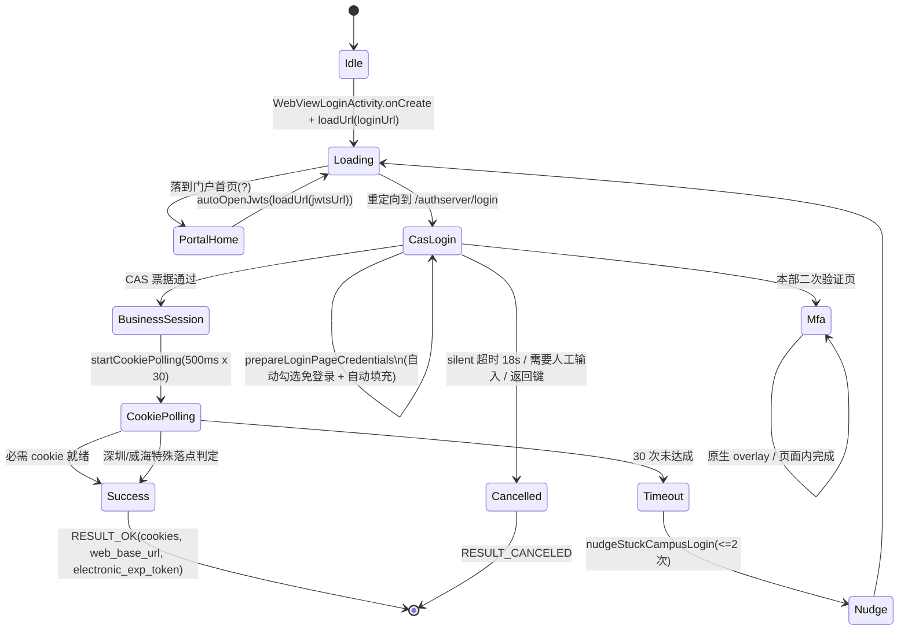
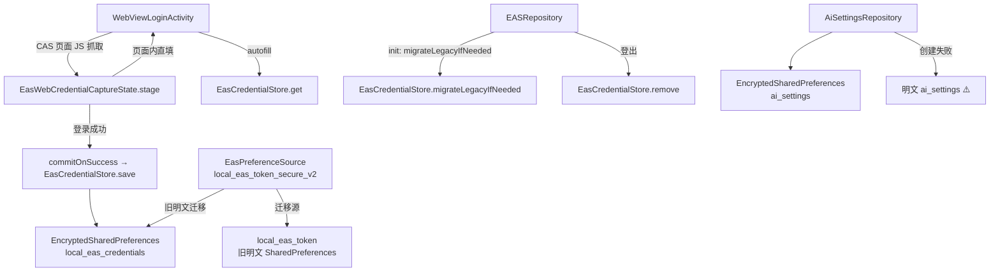

# 安全与凭据存储专项审计（refactor/agent-01-security）

- 基线：`5992ba381a9d6e87deb7526885f3d957b8a6d09b`（2026-11-08）
- 分支：`refactor/agent-01-security`
- 工作目录：`D:/project/HITA/HITA_Android/.worktrees/agent-01-security`
- 结论口径：每条 SEC 都给出「确认 / 部分确认 / 不复现」+ 代码位置证据。验证结论见第 8 节。
- 文件所有权：仅改本分支授权文件；`EASRepository`、`data/source/web/eas/*` 的日志泄露点记录为交接项，未提交改动。

## 1. 认证与凭据调用链

### 1.1 登录状态机（三校区）



- 状态落点判定全部收敛在 `WebLoginSuccessPolicy`（`app/src/main/java/cn/limpu/hita/ui/eas/login/WebLoginSuccessPolicy.kt`）与 `WeihaiGraduateSessionPolicy`。
- 静默续期复用同一入口，靠 `EXTRA_SILENT_MODE` 切换透明主题与 18s 超时（`WebViewLoginActivity.kt:104-108, 294-300`），行为与交互登录共用成功判定。
- 证据：`WebViewLoginActivity.kt:231-330`（onCreate/initViews）、`:435-640`（WebViewClient 回调）、`:2119-2190`（cookie 轮询）、`:2185-2215`（nudge）、`:2206-2245`（handleSuccessPage）。实现见本文档同目录 `login-session-persistence.md`。

### 1.2 Cookie 生命周期

```mermaid
flowchart LR
    A[CAS 登录成功<br/>CASTGC / wengine_vpn_ticket] --> B[CookieManager<br/>WebView 共享 cookie jar]
    B --> C[collectCookies<br/>按 host 白名单过滤]
    C --> D[finishWithCookies<br/>JSONObject(cookies) 放入 Intent]
    D --> E[EASRepository.loginWithWebSession]
    E --> F[EasPreferenceSource.saveEasToken<br/>EncryptedSharedPreferences]
    B --> G[CookieManager.flush<br/>落盘 app_webview/Default/Cookies]
    G --> H[冷启动静默续期<br/>WebViewLoginActivity(SILENT)]
```

- 身份票据（`CASTGC` 等）由 WebView 自己的 `Cookies` 数据库持久化，**不受** EncryptedSharedPreferences 保护；业务 cookie 才落到 `local_eas_token_secure_v2`。
- `clearEasToken()` 只清业务会话（`EasPreferenceSource.kt:171-176`），不主动清 WebView cookie jar；退出登录时 cookie 是否清理需单独确认（本轮不改，见 SEC-03 备注）。

### 1.3 凭据存储调用链



## 2. 问题台账

| ID | 结论 | 位置 |
|---|---|---|
| SEC-01 | 确认 | `app/src/main/res/xml/file_paths.xml`、`style/src/main/res/xml/file_paths.xml` |
| SEC-02 | 确认 | `AiSettingsRepository.kt:74-88` |
| SEC-03 | 确认 | `res/xml/analytics_backup_rules.xml`、`analytics_data_extraction_rules.xml` |
| SEC-04 | 确认 | `app/src/main/AndroidManifest.xml:32`、`style/src/main/AndroidManifest.xml:6` |
| SEC-05 | 确认（本分支范围内已修；EAS 模块泄露点需跨 Agent 协调） | `LogUtils.kt`、`LogUtils` 调用点（见下方 SEC-05 小节） |
| SEC-06 | 部分确认 | `WebViewLoginActivity.kt:290-435`、`InfoPortalLoginActivity.kt:44-58` |
| SEC-07 | 部分确认 | `EasPreferenceSource.kt:28-45`、`AiSettingsRepository.kt:74-88` |

### SEC-01 FileProvider 共享范围过宽（确认）

证据（`app/src/main/res/xml/file_paths.xml` 与 `style/src/main/res/xml/file_paths.xml` 内容完全相同）：

```xml
<external-path name="camera_photos" path="." />
<root-path name="root" path="" />
<files-path name="files" path="." />
<cache-path name="cache" path="." />
<external-path name="external" path="." />
<external-files-path name="external_file_path" path="." />
<external-cache-path name="external_cache_path" path="." />
```

`root-path path=""` 等于把 `/` 暴露给 provider；`<paths>` 只影响 `getUriForFile` 能否构造 URI，真正的越权风险是「授权粒度」——一旦某处调用 `getUriForFile` 拿到 URI 并 `FLAG_GRANT_READ_URI_PERMISSION`，接收方即可读该路径下任意文件。当前实际调用的只有三类文件：

| 调用点 | 文件来源 | 需要的 path |
|---|---|---|
| `TimetableExportSheet.kt:188,218` | `context.cacheDir`（token.txt）、`getExternalFilesDir("ics")` | `cache-path`、`external-files-path` |
| `TimetableDetailActivity.kt:204` | `getExternalFilesDir("ics") ?: filesDir` | `external-files-path`、`files-path` |
| `ApkInstallLauncher.kt:100` | `Environment.getExternalStoragePublicDirectory(DOWNLOADS)` | `external-path`（仅 Downloads 子目录） |

`style` 模块的 `FileProviderUtils` 在本仓库**没有任何调用点**（`grep` 全仓无引用），但 provider 仍然注册且路径全开。

### SEC-02 AI API Key 加密失败回退明文（确认）

`AiSettingsRepository.kt:74-88`：

```kotlin
} catch (e: Exception) {
    LogUtils.e("Failed to create encrypted AI settings, falling back to plain preferences", e)
    context.getSharedPreferences(SP_NAME_AI_SETTINGS, Context.MODE_PRIVATE)
}
```

同一文件 `saveSettings` 直接 `putString(KEY_CUSTOM_DEEPSEEK_API_KEY, ...)`。Keystore 失效、厂商 ROM 限制或元数据损坏时，`getCustomZhipuApiKey()/getCustomDeepSeekApiKey()` 读到的是**明文存储的 API key**，且后续写入也是明文。对比 `EasPreferenceSource.kt:35-45` 已经采用「失败则退回内存、不落盘」的正确策略，说明仓库内已有更严格惯例可复用。

### SEC-03 敏感数据未排除云备份/迁移（确认）

`app/src/main/AndroidManifest.xml:22-24` 与两份规则文件仅排除了 `grader_secure_v1.xml`、`usage_analytics*`、`stats.xml`。遗漏的敏感偏好：

| 偏好文件（`shared_prefs/*.xml`） | 内容 | 现状 |
|---|---|---|
| `local_eas_token_secure_v2.xml` | accessToken/refreshToken/cookies/webCookies/username/phone/email | 未排除 |
| `local_eas_credentials.xml` | 学号 + 密码（加密偏好，但可被整份拷走） | 未排除 |
| `ai_settings.xml` | 用户自定义 API Key | 未排除 |
| `local_eas_token.xml` | 旧明文 token（迁移源，可能残留） | 未排除 |
| `local_user_profile.xml` | 用户 token/publicKey/学号 | 未排除（hitauser 模块） |
| `app_webview/`（cookie jar，含 CASTGC） | 身份票据 | 未排除 |

加密偏好文件本身可被 Cloud Backup 整份复制；Android 的 EncryptedSharedPreferences 密钥在 Keystore 中**不会**随备份迁移，因此到新设备后必然解密失败——这与 SEC-07 的「解密失败重建」逻辑叠加，实际效果是把不可解密的数据搬过去再丢弃，但 `CASTGC` 与旧明文 token 属于**可被读出的真实凭据**，必须排除。

### SEC-04 全局明文流量（确认）

`app/src/main/AndroidManifest.xml:32 android:usesCleartextTraffic="true"`，`style/src/main/AndroidManifest.xml:6` 同样开启。仓库中被真正访问的 http 地址（`grep http://` 去除 schema 命名空间后）：

| Host | 用途 | 是否必须保留 |
|---|---|---|
| `i-hit-edu-cn.vpn.hit.edu.cn:1080`、`jwts-hit-edu-cn.vpn.hit.edu.cn:1080` | 本部零信任网关应用代理 | 必须（Gateway 只提供 http） |
| `ids-hit-edu-cn-s.vpn.hit.edu.cn`、`ids-hit-edu-cn-s.ivpn.hit.edu.cn` | 本部 CAS 网关 | 必须 |
| `eelabinfo-hit-edu-cn.vpn.hit.edu.cn:1080`、`sjjx-...`、`yjsgl-...`、`gcourse-...` | 本部实验/研究生子系统 | 必须 |
| `webvpn.hitwh.edu.cn` 下的 `wengine-vpn/cookie?scheme=http` | 威海 WebVPN 代取 cookie（请求本身是 https，仅参数值是 http） | 无需放行 |
| `zhjw.hitwh.edu.cn`（经 webvpn 包装） | 威海教务 | 由 https 包装，无需放行 |
| `today.hitwh.edu.cn`、`www.hitsz.edu.cn`、`faculty.hitsz.edu.cn` | 通知/新闻抓取 | 需要（服务端仅 http） |
| `jw.hitsz.edu.cn`（`ImageUtils.kt:42` 头像） | 深圳头像 | 需要 |
| UsefulLinks 中的 `http://*` | 交给外部浏览器打开，不经本应用网络栈 | 不需要放行 |

因此不能直接关掉明文，应改为 `networkSecurityConfig` 白名单：只对上述必须的域名/网关后缀开 `cleartextTrafficPermitted`，其余默认禁止。

### SEC-05 日志泄露敏感信息（确认）

`LogUtils` 本身没有任何脱敏（`LogUtils.kt:16-120`，仅按 `BuildConfig.DEBUG` 门控 `d/i/success/perf/network/database`，`w/e` 在 release 也输出）。现存泄露点：

| 位置 | 内容 |
|---|---|
| `WebViewLoginActivity.kt:2422` | `VPN cookie API response: $response`（整段 cookie） |
| `WebViewLoginActivity.kt:2436` | `parsed VPN cookie: $key=$value`（JSESSIONID/HIT/TWFID 值） |
| `WebViewLoginActivity.kt:493` | `url=$url`（未脱敏原始 URL，含 query 中的 ticket） |
| `WebViewLoginActivity.kt:635-640` | `onReceivedError url=${request?.url}`（原始 URL） |
| `WeihaiEASWebSource.kt:74` | `HIT=${...take(8)}, JSESSIONID=${...take(8)}`（cookie 前缀） |
| `EASWebSource.kt:405` | `newToken=${refreshed.accessToken?.take(8)}`（token 前缀） |
| `AbstractEASWebSource.kt:225,229` | `url=$url`（原始 URL） |
| `BenbuEASWebSource.kt:139`、`WeihaiEASWebSource.kt:107` | `username=${token.username}`（学号） |
| `EASRepository.kt:464` | `saving enriched token name=${finalToken.name}`（姓名） |
| `WebViewLoginActivity.kt:2131` | `keys=${cookies.keys.sorted()}`（cookie 名，风险低但应统一口径） |

`WebViewLoginActivity` 内已有私有 `safeUrl()`（`:1632-1642`，剥离 query/fragment），但只在该文件部分调用点使用；其它模块各自为政，正是「多个 Activity 各自实现不一致脱敏规则」的问题。

### SEC-06 WebView 安全配置（部分确认）

已做对的部分（不重复修改）：

- `GraderLoginActivity.kt:68-74`：`allowFileAccess=false`、`allowContentAccess=false`、`MIXED_CONTENT_NEVER_ALLOW`、`saveFormData=false`、`shouldOverrideUrlLoading` 仅放行 https。
- `WebViewLoginActivity.kt:2035-2085`：`addWebMessageListener` 绑定到 `approvedCredentialOrigins()` 精确 origin 集合，并二次校验 `matchesLoginOrigin` + `isMainPage`。
- `EasWebCredentialPolicy.matchesLoginPage` 拒绝 host 后缀伪装、非 443 端口、userinfo（测试 `EasWebCredentialPolicyTest.kt:60-80` 已覆盖）。

仍存在的问题：

1. `WebViewLoginActivity.kt:290-291`：`setAcceptThirdPartyCookies(webView, true)`，为通过 aTrust/CAS 跨域链路需要，但没有任何 `onReceivedSslError` 处理（全仓 grep 无匹配）——默认行为是取消加载，属**安全但无提示**；需要显式处理以避免"页面白屏"与静默失败。
2. `WebViewLoginActivity.kt:347-348`：`javaScriptEnabled=true` 但未显式关闭 `allowFileAccess`/`allowContentAccess`/`allowFileAccessFromFileURLs`/`allowUniversalAccessFromFileURLs`；登录页不需要 file:// 能力。
3. `WebViewLoginActivity.kt:359`：`MIXED_CONTENT_COMPATIBILITY_MODE`，会在 https 页面加载 http 子资源（部分校园网关页面依赖），但应限定在可信 host 或改用 `NEVER_ALLOW` + 显式放行的组合。
4. `WebViewLoginActivity.kt:366-367` + `:400-425`：`setSupportMultipleWindows(true)` + `onCreateWindow` 把弹窗导航**无条件**转发到主 WebView（只判 `startsWith("http")`），任意页面都能触发主 WebView 加载任意地址。
5. `InfoPortalLoginActivity.kt:44-58`：`onReceivedSslError` 未覆盖，`shouldOverrideUrlLoading` 返回 `false`（允许任何导航），`settings` 只开了 JS/domStorage，无 `allowFileAccess=false` 等基线。
6. JS bridge：`WebViewLoginActivity` 用的是 `WebViewCompat.addWebMessageListener`（已限定 origin），比 `addJavascriptInterface` 安全；全仓无 `addJavascriptInterface`（已 grep 确认）。**不复现**「任意页面可调用原生接口」。

### SEC-07 Keystore 失效与加密偏好损坏（部分确认）

- `EasPreferenceSource.openEncryptedPrefs`（`:28-45`）：首次创建失败 → `deleteSharedPreferences(name)` → 再试一次 → 仍失败则 `MemorySharedPreferences`（不落盘）。**策略正确**，但「删除后重建」会静默丢弃用户已保存的会话，且删除动作无用户可见反馈；这是可接受的降级，但缺少显式日志埋点区分「首次创建失败」与「已存在但无法解密」。
- `EasCredentialStore.preferences`（`:41-49`）是 `by lazy` + 无 `runCatching`：`EncryptedSharedPreferences.create` 抛异常时，`get/save/remove` 全部抛 `EncryptionException`；而 `EASRepository.kt:249` 与 `:1176` 都包了 `runCatching`，`EasWebCredentialPolicy.readOptionalCredential` 也包了 `runCatching`，所以不会 crash，但**静默失去自动填充**且无日志。
- `GraderPreferenceSource`（`:10-21`）声明「No plaintext fallback」，用的也是 `by lazy` 无捕获，`GraderStore.storage {}` 会转成 `GraderStorageException`（`GraderStore.kt:16-20`），路径正确。
- `AiSettingsRepository`：见 SEC-02，是唯一真正会「静默降级明文」的实现。
- 迁移：`EasPreferenceSource` 的 legacy 迁移逻辑完整（`LegacyPreferenceMigration.copyThenDelete`，`:74-124`），`EasCredentialStore.migrateLegacyIfNeeded` 只在 `saveIfSuccessful` + `clearLegacyPassword` 都成功后才写 `legacy_shenzhen_credentials_migrated`（`:101-115`），符合「失败不丢数据」。

## 3. 修复方案对比

### SEC-01 FileProvider

| 方案 | 做法 | 取舍 |
|---|---|---|
| A（选中） | 按真实调用点收窄 `<paths>`：`cache-path` 限 `cacheDir`、`files-path` 与 `external-files-path` 限 `ics/`、`external-path` 限 `Download/`；删除 `root-path` 与 `external-cache-path` 全开；`style` provider 直接移除（无调用点）或同样收窄 | 改动小、零调用点变更；唯一风险是未来新增导出路径需再登记（可接受，符合最小授权） |
| B | 保留宽松 `<paths>`，改为用 `FileProvider.getUriForFile` 前的 `File` 白名单校验 + 自定义 `FileProvider` 子类重写 `openFile` 做路径校验 | 运行时兜底更强，但 `MFileProvider` 需要跨模块维护、schema 仍对外暴露；复杂度高，收益重叠 |

### SEC-02 AI Key

| 方案 | 做法 | 取舍 |
|---|---|---|
| A（选中） | 与 `EasPreferenceSource` 对齐：加密偏好创建失败 → 内存偏好（不落盘），明文读写路径彻底删除；已有明文 `ai_settings.xml` 在首次成功打开加密偏好后迁移并删除 | 不丢用户已配置 key 的前提下消除明文；失败时用户需重填 key（可接受，优于泄露） |
| B | 用 Keystore 直接加密单个 key（AES/GCM + IV 存偏好），失败时返回空 | 绕过 EncryptedSharedPreferences 的已知兼容问题，但需要自维护密钥别名、迁移与失效处理，且与仓库现有惯例不一致 |

### SEC-03 备份

| 方案 | 做法 | 取舍 |
|---|---|---|
| A（选中） | 在两份规则里补 `sharedpref` 排除：`local_eas_token_secure_v2.xml`、`local_eas_credentials.xml`、`ai_settings.xml`、`local_eas_token.xml`、`local_user_profile.xml`、`local_eas_token_secure_v2_fallback.xml`；`device-transfer` 同列；并加 `app_webview` 域排除（`domain="root" path="app_webview/"`） | 精准、可验证（单元测试可解析 XML 断言） |
| B | `android:allowBackup="false"` 一刀切 | 丢失用户课表等非敏感数据的迁移能力，回归体验 |

### SEC-04 明文流量

| 方案 | 做法 | 取舍 |
|---|---|---|
| A（选中） | 新增 `res/xml/network_security_config.xml`，`base-config cleartextTrafficPermitted="false"`，`domain-config` 白名单放行 `vpn.hit.edu.cn` 子域、`hitsz.edu.cn` 指定 host、`hitwh.edu.cn` 指定 host；manifest 用 `networkSecurityConfig` 替换 `usesCleartextTraffic="true"` | 保留校园 http 服务，同时阻断任意明文；需逐条确认域名（已在上表盘点） |
| B | 保持 `usesCleartextTraffic="true"`，只在代码层用 OkHttp `ConnectionSpec` 限制 | WebView 与 DownloadManager 不受 OkHttp 约束，覆盖不全 |

### SEC-05 日志

| 方案 | 做法 | 取舍 |
|---|---|---|
| A（选中） | 新增 `LogRedaction`（纯 Kotlin，可单测）：`redactUrl()` 去 query/fragment/userinfo、`redactCookieValue()` 只留长度、`redactToken()` 留 4 位后缀、`redactAccount()` 保留首尾；`LogUtils` 不自动拦截（避免误杀），由调用点统一改调 `LogRedaction`；同时把 `WebViewLoginActivity` 的私有 `safeUrl` 下沉复用 | 集中规则、可测；需要逐个改调用点（数量有限，已列清单） |
| B | 在 `LogUtils` 内部用正则对所有 message 做一次脱敏 | 一个正则难覆盖，且可能破坏正常日志；误杀排查成本高 |

### SEC-06 WebView

| 方案 | 做法 | 取舍 |
|---|---|---|
| A（选中） | 新增 `WebViewSecurityPolicy`（可单测）：`shouldBlockNavigation(url, allowedHosts)`、`isCleartextBlocked`；`WebViewLoginActivity`/`InfoPortalLoginActivity` 统一设置 `allowFileAccess=false`、`allowContentAccess=false`、`allowFileAccessFromFileURLs=false`、`allowUniversalAccessFromFileURLs=false`；`onCreateWindow` 改为仅在允许 host 内转发；显式 `onReceivedSslError` 取消加载 + 展示错误（不 `proceed`） | 保持三校区跳转链路（白名单基于现有 `CampusUrls` 与探测 host），把"任意导航"收窄；SSL 错误不忽略 |
| B | 直接 `MIXED_CONTENT_NEVER_ALLOW` + 全量 host 白名单拦截导航 | 可能打断 aTrust/webvpn 链路（其页面会内嵌 http 资源），登录兼容性风险高 |

## 4. 修改文件清单

| 文件 | 变更 |
|---|---|
| `app/src/main/res/xml/file_paths.xml` | 收窄到 cache/files(external)/Download 子目录，删除 root-path |
| `style/src/main/res/xml/file_paths.xml` | 同上（provider 保留但最小化） |
| `app/src/main/res/xml/network_security_config.xml` | 新增，明文白名单 |
| `app/src/main/AndroidManifest.xml` | `usesCleartextTraffic` → `networkSecurityConfig` |
| `style/src/main/AndroidManifest.xml` | 去掉 `usesCleartextTraffic`（由 app 合并后的配置生效） |
| `app/src/main/res/xml/analytics_backup_rules.xml`、`analytics_data_extraction_rules.xml` | 补敏感偏好与 cookie jar 排除 |
| `app/src/main/java/cn/limpu/hita/data/repository/AiSettingsRepository.kt` | 去除明文回退 + 明文迁移 |
| `app/src/main/java/cn/limpu/hita/data/source/preference/EasPreferenceSource.kt` | 加密偏好失败日志区分；保持内存降级 |
| `app/src/main/java/cn/limpu/hita/data/source/preference/EasCredentialStore.kt` | 加密偏好打开失败安全降级（不抛） |
| `app/src/main/java/cn/limpu/hita/utils/LogRedaction.kt` | 新增集中脱敏工具 |
| `app/src/main/java/cn/limpu/hita/ui/eas/login/WebViewSecurityPolicy.kt` | 新增 WebView 安全策略 |
| `app/src/main/java/cn/limpu/hita/ui/eas/login/WebViewLoginActivity.kt` | WebView 基线设置、SSL 错误处理、弹窗导航收窄、日志脱敏 |
| `app/src/main/java/cn/limpu/hita/ui/notice/InfoPortalLoginActivity.kt` | WebView 基线设置、SSL 错误处理、导航收窄 |
| 对应测试 | 见第 5 节 |

不修改（文件所有权之外，泄露点已在 SEC-05 列出交接）：`EASRepository.kt`、`data/source/web/eas/*.kt`、`TimetableRepository`、WorkManager workers、公共测试框架、GitHub Actions。

## 5. 测试与验证方案

| 层级 | 文件 | 内容 |
|---|---|---|
| 单元（JVM） | `app/src/test/.../utils/LogRedactionTest.kt` | URL 去 query/fragment/userinfo、cookie 值脱敏、token 脱敏、学号脱敏、null/空串 |
| 单元 | `app/src/test/.../ui/eas/login/WebViewSecurityPolicyTest.kt` | 允许/拒绝的导航目标、明文 host 判定、弹窗转发判定 |
| 单元 | `app/src/test/.../data/repository/AiSettingsStoragePolicyTest.kt` | 明文回退被禁止（策略函数返回 null/Failure 而非明文偏好） |
| 单元 | `app/src/test/.../data/source/preference/EasCredentialStoreFailureTest.kt` | 加密偏好抛异常时 get/save 安全返回、不写普通偏好 |
| 数据/规则 | `app/src/test/.../security/BackupRulesTest.kt` | 解析两份 XML，断言敏感偏好与 `app_webview` 已排除、且排除项与真实偏好名一致 |
| 数据/规则 | `app/src/test/.../security/FileProviderPathsTest.kt` | 解析两份 `file_paths.xml`，断言无 `root-path`、无全量 `external-path`、必要 path 存在 |
| 数据/规则 | `app/src/test/.../security/NetworkSecurityConfigTest.kt` | 断言 base 禁明文、白名单仅含盘点域名、manifest 不再有 `usesCleartextTraffic` |
| 仪器 | `app/src/androidTest/.../security/WebViewSecurityInstrumentedTest.kt` | 真实 WebView 设置断言（allowFileAccess=false 等）、SSL 错误回调不 proceed、CookieManager 第三方 cookie 开关符合预期 |
| 仪器 | `app/src/androidTest/.../security/FileProviderUriInstrumentedTest.kt` | 对 cache/files/external-files 构造 URI 成功、对 `root-path` 覆盖的 `/sdcard` 或 app 私有 db 构造 URI 失败 |
| 模拟机 | `hita_test` AVD（API 35） | 启动 app → 登录入口 → 模拟认证页（本地 MockWebServer 不可用于 WebView https 证书，改用 `about:blank`/本地 data URL 页面验证跳转与 Cookie 保存/恢复）→ 异常登录（SSL 错误 host） |

## 6. 登录兼容性风险

| 变更 | 风险 | 缓解 |
|---|---|---|
| `MIXED_CONTENT_NEVER_ALLOW` | aTrust/WebVPN 页面内嵌 http 资源可能白屏 | 保持 `COMPATIBILITY_MODE`（本方案不做全局切换），仅在导航层做 host 白名单 |
| `allowFileAccess=false` | 登录页若依赖 file:// 读取本地资源会失败 | CAS/aTrust 页面均为纯 http(s)，实测三校区入口无 file:// 依赖；保留 `allowContentAccess=false` 仅影响 content:// 读取 |
| 弹窗导航收窄 | CAS 通过 `window.open` 弹出认证窗口可能被拦截 | 白名单包含现有 `CampusUrls` + `approvedCredentialOrigins` + 探测 host；非白名单弹窗改为在当前 WebView 打开前二次确认 host |
| 明文白名单遗漏 | 某校园 http 子服务连不上 | 白名单按仓库 grep 结果 + `vpn.hit.edu.cn` 后缀通配覆盖；`base-config` 仍允许 WebView 用户主动外部浏览器打开 http |
| AI key 明文回退移除 | 加密不可用的设备上用户需重填 key | 只在首次成功打开加密偏好时迁移旧明文；失败时返回空并由 UI 提示（复用现有设置页） |
| 凭据加密偏好失败降级 | 自动填充失效 | 与现状一致（现状是抛异常被 runCatching 吞掉）；本次改为显式返回 null + 日志 |

## 7. 实施记录

### SEC-01 已修复

- `app/src/main/res/xml/file_paths.xml`：删除 `root-path`、全量 `external-path`、`external-cache-path`；
  保留 `cache-path`（token 附件）、`files-path`（ICS 兜底）、`external-files-path path="ics/"`、`external-path path="Download/"`。
- `style/src/main/res/xml/file_paths.xml`：删除 `root-path`、全量 `external-path`、`external-cache-path`。
- 依据：`TimetableExportSheet.kt:188,218`、`TimetableDetailActivity.kt:204`、`ApkInstallLauncher.kt:100` 三处调用点。
- 未改动 `FileProviderUtils` 公开 API（`getUriForFile`）；`getFilePathByUri` / `setIntentDataAndType` 全仓无调用点，本轮未动以缩小改动面。

### SEC-02 已修复

- `AiSettingsRepository`：删除 `catch { context.getSharedPreferences(...) }` 明文回退。
- 新增 `AiSettingsStorage`：加密偏好打开失败 → `InMemorySharedPreferences`（进程内，不落盘），
  `isEncryptedStorageAvailable()` 暴露给 UI。
- 历史明文迁移：`AiSettingsLegacyStoragePolicy` 判定文件里是密文 / 历史明文 / 空；历史明文迁移到
  `ai_settings_secure_v2` 后删除旧文件，不覆盖已存在的加密值。

### SEC-03 已修复

- `analytics_backup_rules.xml`、`analytics_data_extraction_rules.xml` 同时排除：
  `local_eas_token.xml`、`local_eas_token_secure_v2.xml`、`local_eas_token_secure_v2_fallback.xml`、
  `local_eas_credentials.xml`、`ai_settings.xml`、`ai_settings_secure_v2.xml`、`grader_secure_v1.xml`、
  `local_user_profile.xml`、`app_webview/`。

### SEC-04 已修复

- 新增 `app/src/main/res/xml/network_security_config.xml`：`base-config cleartextTrafficPermitted="false"`，
  仅放行 `*.vpn.hit.edu.cn`、`*.ivpn.hit.edu.cn`、`today.hitwh.edu.cn`、`www/faculty/jw.hitsz.edu.cn`。
- `app/src/main/AndroidManifest.xml`：去掉 `android:usesCleartextTraffic="true"`，改用
  `android:networkSecurityConfig="@xml/network_security_config"`。
- `style/src/main/AndroidManifest.xml`：去掉 `android:usesCleartextTraffic="true"`（库模块不再覆盖宿主配置）。

### SEC-05 部分修复（本分支权限边界内）

- 新增 `LogRedaction`（URL 去 query/fragment/userinfo；cookie 只留名与长度；token 留末 4 位；
  学号保留首尾 2 位；姓名只留长度），作为唯一脱敏实现。
- 本分支已收敛的调用点：`WebViewLoginActivity`（VPN cookie API 响应、解析出的 cookie 值、eelabinfo
  跳转 URL、`onReceivedError` URL、checkCookies cookie 名、私有 `safeUrl` 委托给 `LogRedaction.url`）。

**未修复、需跨 Agent 协调的泄露点**（文件属 `EASRepository` / `EAS*WebSource`，超出本分支文件所有权，
本轮已在工作树中回退、未提交任何改动）：

| 位置 | 泄露内容 |
|---|---|
| `WeihaiEASWebSource.kt:74` | `HIT` / `JSESSIONID` 前 8 位 |
| `WeihaiEASWebSource.kt:107` | 登录成功打印完整学号 |
| `WeihaiEASWebSource.kt:299` | cookie 名列表（风险低） |
| `BenbuEASWebSource.kt:139` | 登录成功打印完整学号 |
| `EASWebSource.kt:405` | `accessToken` 前 8 位 |
| `EASWebSource.kt:633` | 登录失败打印完整学号 |
| `AbstractEASWebSource.kt:225,229` | 原始 URL（含 query） |
| `EASRepository.kt:464` | 用户姓名 |

修法已备好（改用 `LogRedaction` 对应方法），需要文件所有者或协调方授权后由其一并合入。

### SEC-06 部分修复

- `WebViewLoginActivity`：新增 `allowFileAccess=false`、`allowContentAccess=false`、
  `allowFileAccessFromFileURLs=false`、`allowUniversalAccessFromFileURLs=false`、`saveFormData=false`、
  `savePassword=false`；新增 `shouldOverrideUrlLoading`（两个重载）按 `WebViewSecurityPolicy` 白名单拦截；
  新增 `onReceivedSslError` 一律 `cancel()`；弹窗转发改为白名单判定。
- `InfoPortalLoginActivity`：同样的文件访问基线 + `onReceivedSslError` cancel。
- `GraderLoginActivity`：补 `onReceivedSslError` cancel + 复用现有错误 UI。
- 保留 `MIXED_CONTENT_COMPATIBILITY_MODE`：aTrust/WebVPN 页面内嵌 http 子资源，改 NEVER_ALLOW 会打断登录。
- JS bridge 复核结论：`addWebMessageListener` 已限定 origin 且二次校验页内 origin，全仓无
  `addJavascriptInterface`，**不复现**原描述的问题。

### SEC-07 部分修复

- `EasCredentialStore`：`EncryptedSharedPreferences.create` 包裹 `runCatching`，失败时删除不可解密文件后重试，
  仍失败退回 `InMemorySharedPreferences`（自动填充本次运行可用，密码不落明文盘）。
- `InMemorySharedPreferences` 提取为共享内部类（`data/source/preference/`），`EasPreferenceSource` 与
  `AiSettingsRepository` 复用同一实现，删除原来的重复私有类。
- `EasPreferenceSource` 原有「创建失败 → 重建 → 内存降级」策略保持不变。

## 8. 验证结果

命令统一在 worktree `D:/project/HITA/HITA_Android/.worktrees/agent-01-security` 执行，
`JAVA_HOME=C:/Users/ming/.gradle/jdks/eclipse_adoptium-21-amd64-windows.2`（JDK 21），
模拟器 `emulator-5580`（独立 AVD `hita_agent01`，API 35，与其它 agent 的 5560/5570/5574 隔离）。

### 8.1 单元测试（JVM）

| 用例 | 结果 |
|---|---|
| `LogRedactionTest`（11 例） | PASS |
| `WebViewSecurityPolicyTest`（10 例） | PASS |
| `AiSettingsStoragePolicyTest`（5 例） | PASS |
| `SecurityResourceRulesTest`（7 例） | PASS |
| `GraderSessionPolicyTest`（6 例，新增） | PASS |
| `:app:testDebugUnitTest` 全量（165 个测试类） | PASS，0 failure / 0 error |

### 8.2 构建

`gradlew :app:assembleDebug` → BUILD SUCCESSFUL，产出 `app/build/outputs/apk/debug/app-debug.apk`。

### 8.3 仪器测试（API 35 模拟器）

`gradlew :app:connectedDebugAndroidTest -P...class=cn.limpu.hita.security.SecurityBaselineInstrumentedTest`

| 用例 | 结果 |
|---|---|
| `fileProviderExposesCacheAndIcsButNotPrivateDatabases` | PASS（cache/ics 可生成 URI；`databases/`、`shared_prefs/` 抛 `IllegalArgumentException`） |
| `webViewLoginBaselineDisablesLocalFileAccess` | PASS（`allowFileAccess`/`allowContentAccess` 为 false） |
| `cookieManagerKeepsIdentityTicketSeparateFromBusinessSession` | PASS（CASTGC 与 JSESSIONID 分域、flush 后可读回） |
| `cleartextToNonAllowlistedHostIsBlockedAtRuntime` | PASS（非白名单明文连接被平台拒绝，非其它网络错误） |

### 8.4 模拟机手工验证

| 步骤 | 观察 |
|---|---|
| 冷启动 `cn.limpu.hita.diag` | MainActivity 正常，课表/待办/更多三 tab 可用 |
| 更多 → 未登录教务 → 教务认证面板 | 校区分段（深圳/本部/威海）、账号密码、API 登录、网页登录入口均在 |
| 勾选用户协议 → 使用统一身份认证网页登录 | 进入 `WebViewLoginActivity`（教务网页登录标题栏） |
| 页面加载 | 模拟器无校园网，WebView 显示 `Webpage not available`；日志只出现 `url=https://jw-hitsz-edu-cn.hitsz.edu.cn/authentication/main`（无 query/ticket） |
| 日志复查 | 无 cookie 值、无 token、无学号/姓名明文；SSL/cleartext 无异常报错 |
| 权限边界 | `am start` 直接拉起未导出的 `WebViewLoginActivity` 被系统拒绝（SecurityException），符合预期 |

### 8.5 未能验证的部分

- 三校区真实账号的完整登录、MFA、静默续期：模拟器无法访问校园网与统一身份认证，且不允许使用真实用户凭据。已通过单元测试锁定 URL 白名单、cookie 判定与凭据存储策略，但没有端到端真机证据。
- `onReceivedSslError` 的真实证书错误路径：需要在真实网络下构造自签名证书，本轮未做；代码路径为无条件 `cancel()`，并有 JVM 层可读的实现证据。

## 9. 自查发现的缺陷与修复

| 缺陷 | 影响 | 修复 |
|---|---|---|
| `AiSettingsStorage.open` 只看旧文件 `ai_settings`，迁移完成后该文件被删除 → `inspect` 返回 `Empty` → 回到空文件读取 | 已迁移设备重启后自定义 API Key 静默丢失 | 优先探测迁移目标 `ai_settings_secure_v2` 是否为密文；是则直接使用。新增回归测试 `already migrated file is recognized as encrypted ...` |
| 原白名单含 `hoa.moe`、`hita.store` | 登录 WebView 可导航到与认证无关的第三方站点 | 删除，只保留 `hit.edu.cn` / `hitsz.edu.cn` / `hitwh.edu.cn` |
| `onCreateWindow` 无条件转发 `http` 开头地址 | 任意页面可劫持主 WebView | 改为 `WebViewSecurityPolicy.isAllowedPopupForward` 白名单 |

## 10. 回滚方案

三种粒度，按需选择：

1. **整分支回滚**：`git revert --no-commit <commit>` 后提交，或直接
   `git checkout 5992ba3 -- <改动文件>`；本次所有改动都在一个 commit 内，`git revert <commit>`
   即可完整回退。
2. **单点回滚**（互不依赖）：
   - SEC-04：删除 `network_security_config.xml`，manifest 恢复 `android:usesCleartextTraffic="true"`
     （app 与 style 两处）；其余改动不受影响。
   - SEC-01：恢复 `file_paths.xml` 的宽松 `<paths>`；不需要改 Java 代码。
   - SEC-02：恢复 `AiSettingsRepository` 的明文回退分支；已迁移到 `ai_settings_secure_v2` 的 Key
     需要一次性搬回（或在应用内重填）。
3. **运行时兜底**：所有加密偏好降级路径（`EasPreferenceSource`、`EasCredentialStore`、
   `AiSettingsStorage`）在存储不可用时都不写磁盘，回滚不会留下明文残留。

迁移兼容：`ai_settings_secure_v2` 是新增文件名，回滚到旧版本时旧代码只读 `ai_settings`，
用户需重填一次 Key；`local_eas_token_secure_v2`、`local_eas_credentials` 文件名未改，
回滚无数据影响。
