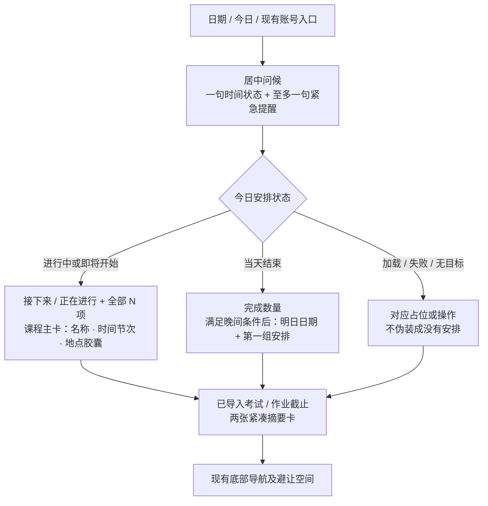

# 今日页视觉重做方案与示意

日期：2026-11-18；Android 基线：`af8f3404`；状态：视觉与文案已确认，应用实现、相关 JVM 48 项及设备 36 项验证完成；见[实施记录](../../audit/2026-11-18-today-redesign.md)。

承接[首期信息与数据设计](2026-11-16-today-page-optimization-design.md)及[首期接入记录](../../audit/2026-11-17-today-ui.md)。本方案修正已接入页面的视觉问题，并将原第二期 A 的考试、作业两张摘要卡纳入本轮拟实施范围；本文件记录已确认方案，应用实现及验证见实施记录。

后续布局调整（摘要固定在底栏上方、课表切换、已结束项折叠）见[固定摘要与课表切换布局设计](2026-11-18-today-fixed-summary-layout-design.md)；该文列出了它替代本文的条目，代码接入和待补真机项见[实施记录](../../audit/2026-11-18-today-fixed-layout.md)。

## 1. 重做目标

打开页面先感知“现在该做什么”，再看到“还有什么要注意”。首屏的视觉顺序固定为：日期/页名 → 问候及一句状态 → 当前/下一组安排 → 考试与作业摘要。

当前版本的问题不是单个颜色，而是结构：大段左对齐文字与重复状态将页面拉成长清单；课程前出现多行来源说明；课程名、日期、地点、状态逐行铺开，缺少主次；结束项与下一项外观过于接近。

这轮以 iOS 今日页的构图、密度与组件关系为参考，保留 Android 数据与交互语义。示意中的课程、教师、考试与作业均为虚构数据，不代表真实账号记录。

## 2. iOS 对照与取舍

参考 `HIT-A/HITA-Aura@26b06d0375d50b436fdd8a1557293654a67f8e67` 的 `HITAAura/Views/Today/TodayHomeView.swift`，已重新读取源码；这不是 iOS 运行截图或对当前 iOS 最新版本的验收。

| iOS 源码要点 | 拟落实到 Android |
|---|---|
| `heroTitleSize = 34`，居中圆润粗体问候，副文案独立 | 34sp 居中问候，下方一行当前/下一项状态，最多一行紧急提醒 |
| 课程区在 `discoveryCards` 前 | 调整布局顺序，摘要不再挤在课程之前 |
| 课程标题 19、卡片圆角 26、左侧 5pt 课程色条 | 19sp 课程名、24dp 圆角（按示意反馈调整）、4dp 色条，完整时间与节次使用次级文字 |
| 地点胶囊最小高度 44，普通宽度约 96 | 右侧地点胶囊约 88–104dp、点击区域至少 48dp；长名称/大字体时移到下一行 |
| 标题旁“全部 N 节”胶囊 | “接下来 / 今天的安排”旁放“全部 N 项 / 收起”，贴近标题；不把操作推到另一端 |
| 完成卡把已完成数量与明日准备组合呈现 | 折叠时显示紧凑完成卡，晚间合入明日首组；展开后另列历史，明日内容只出现一次 |
| 资讯与四个小入口组成 discovery 区 | 本轮只做两列考试/作业，不创建资讯、资源或 Agent 占位卡 |

不照搬“默认只保留第一节课”的数据规则：Android 仍保留所有进行中日程和下一组，个人安排、考试与冲突项不得被视觉简化丢弃。天气、定位、地图仍不进入本轮。

## 3. 页面示意结构

配套的交互示意支持：接下来、进行中、晚间准备、冲突、来源异常、今日空表、读取中、未选课表；“全部安排”可展开，课程及摘要可打开详情示意。预览只演示信息层级，不执行真实路由、同步或写入。

## 4. 排版与尺寸规范

以下为 390dp 左右宽度、系统标准字号下的目标比例，内容增多时允许增长，不使用固定卡片高度裁切文字。

| 元素 | 目标规格 |
|---|---|
| 页面左右边距 | 20dp；卡片、区标题和页头基线对齐 |
| 页面标题 | 28–32sp，粗体；日期/星期 12–13sp；沿用主界面标题职责，避免 Fragment 重复再画日期 |
| 问候 | 34sp，粗体、居中；普通状态一行，长文案自然换行 |
| 问候副文案 | 14sp；当前/下一项剩余时间；不重复完整课程名 |
| 次级紧急提醒 | 12sp，最多一行摘要，超量内容由下方卡片承载，不缩小字号硬塞 |
| 问候区域 | 内容驱动，标题上下留白约 24–32dp；不填充大图、天气占位或固定巨大高度 |
| 区标题 | 19sp、较粗；与列表间距 12–14dp |
| 课程标题 | 19sp、较粗；正常尺寸优先两行，大字体允许更多行，不强制省略关键信息 |
| 时间/节次 | 13–14sp、次级色、数字等宽；今日通常只显示 HH:mm–HH:mm |
| 跨日时间 | 补充日期或“次日”标记，不能用普通同日格式误导；异常时间明确标注 |
| 地点 | 13–14sp、较粗；胶囊横向内边距 12dp；未知时显示“地点待确认” |
| 课程卡 | 圆角 24dp，内边距 18–20dp，左侧色条 4dp；普通单项目标高度约 104–132dp |
| 已结束项 | 降低背景饱和度与标题强调；16–17sp 标题、时间仍可读，目标高度约 80–100dp |
| 两张摘要卡 | 间距 12dp，内边距 14–16dp，圆角 22–24dp；标签 12–13sp、数字 24–28sp、说明 12sp |
| 点击区域 | 所有真实动作至少 48dp；胶囊不与主卡形成嵌套重复点击 |
| 区块间距 | 安排与摘要 18–20dp；同组卡片 10–12dp |
| 底部避让 | 从现有导航、mini 条和系统 inset 计算；禁止最后一项停在底栏后面 |

预览中的完整手机框用于解释比例；实际开发复用 MainActivity 的日期/账号/底栏宿主，只实现 Fragment 内容，避免把图中的壳层重复搭一遍。

## 5. 颜色与材质

- 采用现有 `HitaTheme` 与风格卡片工具，新增今日页语义样式映射，不在业务组件中散落固定 RGB。
- 背景、正文、次级文字、容器由现有主题提供；普通背景安静，正文对比明确，来源说明不能低到难以阅读。
- 当前/下一项用课程颜色的低饱和浅填充和左侧色条识别。深色使用更低亮度的同色容器；对不适合作文字的课程色，正文仍用主题正文色。
- 完成状态用低饱和中性色；逾期与冲突有短文字说明，颜色只是辅助，不把整块涂成警报色。
- 玻璃主题沿用现有材质能力与描边；普通主题不加厚阴影、多层边框。示意的紫色是示例课程色，不要求把所有主题改为紫色。
- 不新增背景大图、动画渐变或装饰粒子。已有主题自带的材质保留，不能覆盖其可访问性与系统减少动态设置。

## 6. 组件行为

### 问候与安排

- 问候居中，但焦点只表达一件事：“距下一项开始 12 分钟”或“距当前结束 57 分钟”；有冲突显示数量，不挑任意标题冒充唯一事件。
- 紧急提醒只在有可信内容时显示，优先未结束考试，再提示今日截止；没有可用来源就省略该句，不编造“今天没有任务”。
- 完整名称、时间、节次和地点留在课程卡。教师仅作为可选辅助文字，空间不足时优先保证时间地点。
- 进度条只在有效进行中事件出现，高度约 3dp；不增加进度百分比大字。
- 默认集合与当前投影相同；展开后保留所有真实事件，含考试、个人安排、异常时间。TAG 提示不计数。
- 冲突组全部展示，并加一行“同一时段 N 项安排”；跨午夜保留原始区间；短格式由显示适配层统一处理。
- 展开/滚动仍以目标与日期保存；分钟、摘要刷新和切 Tab 不重置。轻量展开过渡仅由用户动作触发，不每分钟整屏重播。

### 完成与明日准备

- 当天结束使用“今天已结束 N 项安排”，不把课程结束说成作业全部完成。
- 只有原有 20:30 门槛及全部有效日程结束条件满足，才在完成卡内加分隔线和明日日期/首组。
- 明日同刻多项全部展示；无日程与时间待核对分开；不可因版面紧凑只留一项。
- 展开历史时完成卡仍在列表前方，明日部分只渲染一次；历史项收紧，仍可点击详情。

### 两张摘要卡

考试卡固定注明“已导入考试”或同样明确的范围，数字只表示当前目标中可核对的待参加数量。今日没有已导入记录可以显示“已导入 0 场”，不能写成“今天没有考试”；教务未知/未覆盖时保留简短来源提示。时间缺失以“时间待确认 N 场”单列，失败保留标注“本地记录”，未绑定结果不混进目标数字。

作业卡在两来源均已知时，可用“今日截止 2 项”作为视觉主值，并持续显示“手写 1 · Grader 1”的分项身份，不按标题合并。任一来源未知时，主值改为明确来源的已知统计，如“手写 1 项”，另写“Grader 未连接”；不能显示总数 1 项。逾期单独标记，不与今日待截止相加，无期限/异常期限保留短提示或进入来源明细。

卡片点击进入既有考试/作业路由；失败的本地读取动作放在对应详情或局部操作行，不扩大成整页错误。卡片和详情仅展示具体考试、作业、来源名称与简短状态，不展示数据关联、覆盖范围、统计规则等解释段落。账号隔离、来源绑定和未知状态继续由数据层及测试保证；不为这些规则新增说明弹层。

### 文案原则（本次反馈）

- 保留现在的布局与卡片比例，课程卡圆角采用示意中选定的 24dp。
- 删除首屏、详情和弹层中的防御性解释；不将数据实现规则写成用户提示。
- 状态用简短标签表达：“未连接”“待查询”“读取失败”“时间待确认”。需要操作时直接给出入口。
- 摘要和详情展示名称、时间、地点、数量及来源分项；删去“查看范围”等附加说明。
- 空状态直接表达“暂无考试记录”“今天暂无安排”，不追加解释其他区域仍可使用的文字。

### 自适应与异常

- 窄屏或大字体下两张摘要卡回退为单列；课程地点移到次行，禁止让课程名只剩狭窄一条。
- 标准 390dp 宽度首屏应能看到主课程的完整时间/地点及摘要卡；不能靠缩小系统字号达成。
- 读取中使用稳定骨架；无目标显示选择/导入；空表只描述课表范围；读取失败显示局部错误与保留内容。上述状态保留布局层级，但不能伪装成相同的“无安排”。

## 7. 拟修改文件与边界

| 文件 | 拟改职责 |
|---|---|
| `TodayScreen.kt` | 仅编排：问候 → 安排/完成 → 摘要 → 提示；保留目标/日期状态容器与稳定 key |
| 新 `TodayHeader.kt` | 居中问候与一句焦点，去掉长摘要堆叠 |
| 新 `TodayAgenda.kt` | 主课程卡、标题旁胶囊、冲突组、完成项紧凑样式 |
| 新 `TomorrowPreparationCard.kt` | 完成卡与明日首组组合，避免折叠/展开重复渲染 |
| 新 `TodaySummaryCards.kt` | 两张摘要卡、来源提示与大字体单列 |
| 新 `TodayVisualStyle.kt` | 字号、间距、主题到今日页语义颜色/材质的集中映射；不另建主题偏好 |
| `strings.xml` | 精简状态与来源文案、时间/跨日格式、无障碍标签 |
| 既有今日 UI 设备测试 | 更新查找与排版断言，保留事件 ID、来源范围及状态恢复回归 |
| `MainTopBar.kt` 的 TIMELINE 分支 | 拟将当前单行日期标题调整为小号日期＋“今日”两级结构，复用账号/抽屉入口；其他 Tab 的 `ToolbarTitle` 保持原样，不全局改字号 |

现有 `TodayProjection`、`TodayHomeworkProjection`、`TodayExamProjection`、`DisplayScopeResolver` 与 Repository 不因视觉重做改写。允许增加纯显示格式适配，不改 Room、网络、账号、时间判定、课表采纳和隐藏规则，不创建第二个计数实现。

## 8. 实施顺序与验收

1. 本方案、卡片比例及短文案已获确认，按下列步骤实施。
2. 先实现居中问候、主课程与完成/明日组合，在真机对照标准字号和长标题；截图确认后再收尾材质。
3. 接入两张摘要卡与简短状态，复用现有数据状态和导航；覆盖未知、失败、逾期与不完整时间。
4. 检查 320dp/390dp、1.0/1.3/1.6 字体缩放、浅/深色，以及经典/玻璃/波普等现有主题。大字体以可读和完整操作为准，不强求卡片同高或一屏塞满。
5. 复跑既有今日状态与 UI 回归；新增有意义的窄屏/大字体、跨日时间、摘要未知不显示总零、冲突全量展示和明日不重复场景，不为每个装饰常量写测试。
6. 构建 Debug、仓库检查、`git diff --check`；设备安装使用 `adb install -r` 保留数据。记录实际截图及首屏可见信息，不以构建/测试数量代替视觉验收。实现完成后按仓库约定提交，push 仍单独确认。

### 本次方案验证

- 已读 Android 当前页面及固定 iOS 参考源码，方案与交互示意同步检查。
- 已用 Chromium 检查八种状态、全部展开、课程/来源明细、明日部分只出现一次、320px 窄屏与 1.35 倍字体下的深色布局；无脚本异常、无横向溢出。已目视检查白天、晚间与窄屏深色示意，中文正常显示。预览中可用外观/字体比例/圆角设计控件作对比。
- 浏览器验证与图像记录：`/home/rinat/projects/HITA-artifacts/today-design-2026-11-18/`，含 `day.png`、`evening.png`、`day-dark.png`、`narrow-large-dark.png` 与 `check_preview.py`。交互示意位于本会话示意目录的 `today-visual-redesign.html`。
- 交互示意是独立提案，不证明 Compose 已实现、手机效果或真实数据服务已通过。
- 以上为方案阶段的示意验证；确认后的应用构建、安装和设备结果记录在[实施记录](../../audit/2026-11-18-today-redesign.md)。
